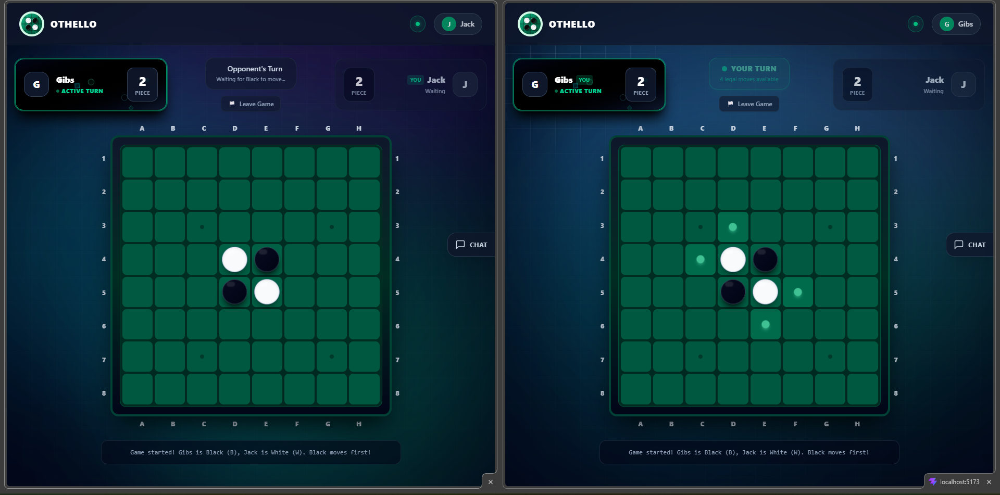
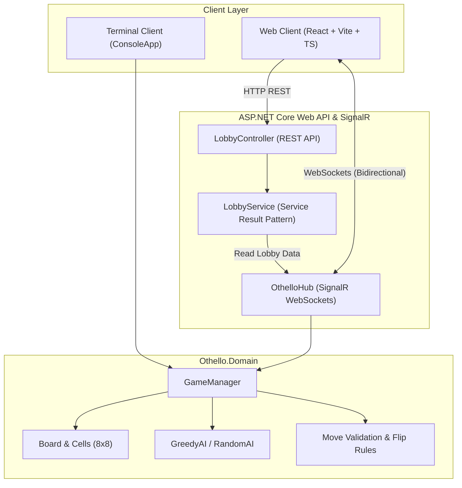

# 🎮 Othello – Real-Time Multiplayer & AI Platform

[](https://dotnet.microsoft.com/)
[](https://learn.microsoft.com/aspnet/core/signalr/)
[](https://react.dev/)
[](https://www.typescriptlang.org/)
[](https://vitejs.dev/)
[](https://tailwindcss.com/)

A modern, full-stack implementation of the classic strategy board game **Othello**. Features real-time online multiplayer over WebSockets (SignalR), interactive lobby management, direct player-to-player challenges, live chat, single-player mode against an intelligent heuristic AI, and an interactive terminal console client.

---

## 📸 Gameplay Preview



---

## 🌟 Key Features

### 🧠 1. Pure Domain Game Engine (`Othello.Domain`)
- **Official Othello Rules**: Full 8x8 grid mechanics with directional bracket raycasting in all 8 directions (horizontal, vertical, diagonal).
- **Turn & Score Management**: Automatic calculation of valid moves, turn skipping when no legal moves exist, dynamic score updates, and game over detection.
- **Modular AI Opponents**:
  - `GreedyAIPlayer`: Evaluates board states and selects the move yielding the highest flip count.
  - `RandomAIPlayer`: Makes stochastic valid moves for casual play.

### ⚡ 2. Real-Time Multiplayer & SignalR Hub (`Othello.Api`)
- **Real-Time WebSocket Synchronization**: Sub-millisecond state broadcasts powered by ASP.NET Core SignalR (`OthelloHub`).
- **Lobby Management & Matchmaking**:
  - Public & password-protected private lobbies.
  - Automatic host migration if the room creator leaves.
  - Seamless match initialization and room status syncing.
- **30-Second Disconnection Grace Period & Forfeit**:
  - If a player disconnects mid-match, the server initiates a 30-second countdown grace period instead of immediately dropping the game.
  - The remaining player is informed via a live countdown modal with progress animation.
  - If the player reconnects within 30 seconds, the game state resynchronizes and resumes seamlessly.
  - If the countdown elapses, the remaining player automatically wins by **forfeit**, and the room is safely disbanded.
- **Interactive Chat & Direct Challenges**:
  - Global and room-specific chat channels.
  - Live online player counter and presence list.
  - **1-Click Direct Challenges**: Challenge online players directly from chat with interactive challenge notification popups.

### 🏛️ 3. Backend Architecture & Service Result Pattern
- **Controller-Based REST API**: Migrated from Minimal APIs to clean, maintainable ASP.NET Core Controllers (`LobbyController`).
- **Service Result Pattern**: Clean separation of HTTP concerns from business logic via `ServiceResult<T>`, `ServiceErrorType`, and `ILobbyService`.
- **CORS & Resilience**: Configured for local development and multi-client environments with automatic reconnection resilience.

### 🎨 4. Modern Cyber Glassmorphism UI (`Frontend`)
- **Tech Stack**: React 19, TypeScript, Vite, Tailwind CSS v4.
- **Selectable AI Opponents**: Interactive engine picker supporting tactical Greedy AI (🤖) and casual Random AI (🎲) with distinct themes.
- **Visual Feedback**: Ambient particle effects, glowing active turn indicators, valid move markers with hover previews, and celebratory game over modals.
- **Responsive Layout**: Designed for seamless experience on desktop and mobile viewports.
- **Session Continuity**: Browser tab isolation via `sessionStorage` allowing multiple local player identities for side-by-side testing.

### 💻 5. Console Client (`Othello.ConsoleApp`)
- Interactive CLI client providing full terminal-based Othello gameplay for human-vs-human and human-vs-AI modes.

---

## 📐 System Architecture



---

## 📁 Project Structure

```text
Othello Game/
├── Backend/
│   ├── Othello.sln                    # .NET Solution file
│   ├── Othello.Domain/                # Pure Core Domain Library
│   │   ├── Board.cs                   # 8x8 Grid and Cell matrix
│   │   ├── Cell.cs                    # Cell state & piece holder
│   │   ├── GameManager.cs             # Master game orchestrator & rules
│   │   ├── GreedyAIPlayer.cs          # Heuristic AI implementation
│   │   ├── RandomAIPlayer.cs          # Stochastic AI player
│   │   ├── Move.cs / MoveResult.cs    # Move descriptors and outcome DTOs
│   │   └── Interfaces/                # IPlayer, IBoard, ICell, IPiece, IAutoPlayer
│   ├── Othello.Api/                   # ASP.NET Core 8 Web API & SignalR Server
│   │   ├── Common/                    # ServiceResult<T> & Result Pattern helpers
│   │   ├── Controllers/               # LobbyController (REST endpoints)
│   │   ├── Dtos/                      # Request/Response data transfer objects
│   │   ├── Hubs/                      # OthelloHub, IGameClient, Service contracts
│   │   ├── Services/                  # ILobbyService, LobbyService, GameSessionService
│   │   └── Program.cs                 # API bootstrapper, CORS, DI, route mappings
│   └── Othello.ConsoleApp/            # Interactive CLI terminal client
│       └── Program.cs                 # Console UI & gameplay loop
│
├── Frontend/                          # React + TypeScript + Vite Client
│   ├── src/
│   │   ├── components/                # Modular UI components
│   │   │   ├── chat/                  # ChatSidebar with channels & challenge action
│   │   │   ├── game/                  # MatchView (HUD, 8x8 Board, Disconnection Modal)
│   │   │   ├── lobby/                 # LobbyBrowser, LobbyRoom, CreateLobbyModal
│   │   │   ├── notifications/         # Direct Challenge & Lobby Alert popups
│   │   │   ├── Navbar.tsx             # Navigation bar & editable player nickname
│   │   │   └── ModeSelection.tsx      # Main menu mode selection (AI vs Online)
│   │   ├── services/
│   │   │   ├── api.ts                 # Fetch wrapper for Lobby REST API
│   │   │   └── signal_r.ts            # SignalR connection hook (useOthelloSignalR)
│   │   ├── types/                     # TypeScript game and DTO interfaces
│   │   ├── App.tsx                    # Root application component & view manager
│   │   └── main.tsx                   # React entry point
│   ├── vite.config.ts                 # Vite bundler configuration & dev server proxy
│   └── package.json                   # Frontend dependencies and npm scripts
│
├── gameplay.png                       # Gameplay preview screenshot
└── README.md                          # Project documentation
```

---

## 🚀 Getting Started

### Prerequisites
Make sure the following runtimes and tools are installed on your system:
- **[.NET 8.0 SDK](https://dotnet.microsoft.com/download/dotnet/8.0)**
- **[Node.js](https://nodejs.org/)** (v18.x or later) & **npm**

---

### 1. Running the Backend API

1. Navigate to the backend directory:
   ```bash
   cd Backend
   ```
2. Restore dependencies and build the solution:
   ```bash
   dotnet build Othello.sln
   ```
3. Run the Web API project:
   ```bash
   dotnet run --project Othello.Api/Othello.Api.csproj --launch-profile "http"
   ```
   The backend server will start listening on:
   - **HTTP API**: `http://localhost:5057`
   - **SignalR Hub**: `http://localhost:5057/othello/hub`

---

### 2. Running the Frontend Web Client

1. Open a new terminal and navigate to the frontend folder:
   ```bash
   cd Frontend
   ```
2. Install npm packages:
   ```bash
   npm install
   ```
3. Start the Vite development server:
   ```bash
   npm run dev
   ```
4. Open your browser and navigate to:
   ```text
   http://localhost:5173
   ```
   *(The Vite development server is pre-configured to proxy `/api` and `/othello/hub` calls directly to `http://localhost:5057`)*.

> [!TIP]
> **Testing Multiplayer Locally**: Open two separate browser windows (or an Incognito window) to `http://localhost:5173`. Each session receives its own randomized player username, allowing you to create a room in one tab and join/challenge from the other!

---

### 3. Running the Console Terminal Game (Optional)

If you wish to test the core game logic via the terminal:
```bash
dotnet run --project Backend/Othello.ConsoleApp/Othello.ConsoleApp.csproj
```

---

## 📡 API & SignalR Reference

### REST Endpoints (`LobbyController`)

All endpoints implement the **Service Result Pattern** returning standardized responses:

| Method | Endpoint | Description | Success Response |
| :--- | :--- | :--- | :--- |
| `GET` | `/api/lobby` | Fetch all active public lobbies | `200 OK` (Array of lobbies) |
| `GET` | `/api/lobby/{id}` | Fetch details of a specific lobby by ID | `200 OK` (Lobby details) or `404 Not Found` |
| `GET` | `/api/lobby/player/{playerName}` | Retrieve current active lobby for a player | `200 OK` (Lobby details) or `404 Not Found` |

### SignalR WebSocket Hub (`/othello/hub`)

#### Client Invocations (Client → Server)
- `CreateLobby(CreateLobbyDto dto)`: Creates a new waiting room or AI match session.
- `JoinLobby(JoinLobbyDto dto)`: Joins an existing room or reconnects an existing session.
- `LeaveLobby(LeaveLobbyDto dto)`: Leaves a waiting room or forfeits an active match.
- `StartGame(StartGameDto dto)`: Starts the Othello match for a full lobby.
- `MakeMove(MakeMoveDto dto)`: Submits a piece placement `(row, col)`.
- `PostChat(SendChatDto dto)`: Sends a message to global or room chat.
- `GetOnlinePlayersCount()`: Requests current server-wide connected player count.

#### Server Broadcasts (Server → Client)
- `ReceiveGameState(GameStateDto state)`: Emits board matrix (8x8), valid moves, scores, turn, and game status.
- `MovePlayed(MoveResultDto move)`: Notifies clients of the move location and flipped piece count.
- `GameOver(string result, int blackScore, int whiteScore)`: Broadcasts game termination and winner.
- `OpponentDisconnected(string playerName, int timeoutSeconds)`: Triggers the 30-second forfeit countdown modal.
- `OpponentReconnected(string playerName)`: Dismisses the countdown modal and resumes play.
- `ReceiveChat(ReceiveChatDto chat)`: Streams incoming chat messages and challenge payloads.
- `OnlinePlayersCountChanged(int count)`: Updates real-time online player counter.
- `LobbyDeleted(string message)`: Notifies members that a lobby has been disbanded.

---

## 📜 Game Rules Summary (Othello)

1. **Objective**: Have the majority of your color's pieces displayed on the board when the game ends.
2. **Initial Setup**: Four pieces are placed in the center of the 8x8 grid (two Black, two White diagonal from each other). Black moves first.
3. **Flanking & Flipping**: A legal move requires trapping one or more opponent pieces in a continuous straight line (horizontal, vertical, or diagonal) between the newly placed piece and another piece of your color. All trapped opponent pieces are flipped to your color.
4. **Passing**: If a player has no legal moves, their turn is automatically skipped.
5. **Game Over**: The game concludes when neither player has any legal moves (e.g., board is full or all pieces of one color are eliminated). The player with the highest piece count wins.

---

## 🛠️ Built With

- **Backend**: C# 12, .NET 8.0, ASP.NET Core Web API, SignalR WebSockets.
- **Frontend**: React 19, TypeScript, Vite, Tailwind CSS v4.
- **Tooling**: JetBrains Rider, Visual Studio, VS Code, Git.

